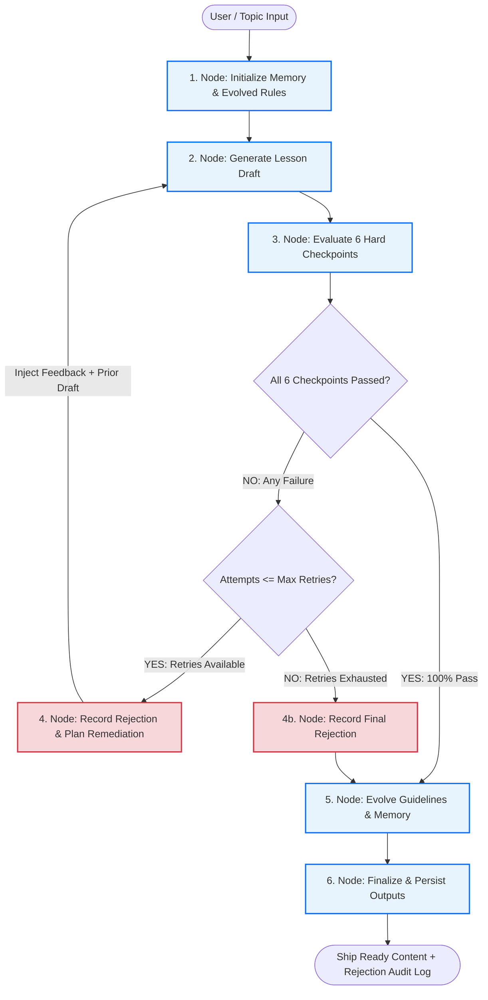

# System Architecture & Design Document
## Self-Evaluating Lesson Content Generator

> **Submission Topic:** Introduction to RAG (Retrieval-Augmented Generation)  
> **Target Audience:** Zero-background beginner (assumes no prior CS or AI knowledge)  
> **Core Principle:** Autonomous generate ➔ evaluate ➔ regenerate loop with hard binary checkpoints before human review.

---

## 1. System Vision & Planning

The fundamental problem with typical AI content generation is **evaluator leniency** and **unstructured feedback drift**. When asked to "write a lesson and improve it," naive LLM prompts either:
1. Suffer from partial-credit ambiguity (giving 7/10 or 8/10 without fixing critical gaps).
2. Fail to identify why beginner readers get lost (dropping jargon like *embeddings*, *vector DB*, or *cosine distance* without intuitive translation).
3. Drift off-topic or enter infinite loops without bounded termination.

### System Goals
- **Autonomous Quality Gate:** Content must pass a strict 6-checkpoint pedagogical rubric before being considered shippable.
- **Hard Binary Decisions:** No partial credit. A checkpoint either strictly passes or fails. A single failure rejects the draft and halts shipment.
- **Diagnostic Feedback Injection:** Instead of a generic "try again", the evaluator produces a structured critique identifying exact evidence, failure reasons, and prescriptive remediation items.
- **Bounded Cycle Guarantee:** Hard cap of 1–2 retries (maximum 3 attempts total) ensures deterministic termination.
- **Cross-Run Memory & Self-Evolution:** Failures encountered during generation runs are analyzed, extracted as anti-patterns, and persisted in memory to sharpen future prompts and rubrics.

---

## 2. End-to-End Workflow Architecture

The system is architected as an agentic cyclic graph using **LangGraph**:

---

## 3. Rubric Design: 6 Hard Pass/Fail Checkpoints

The rubric deliberately rejects scalar grading (e.g. 1–10) in favor of **binary pass/fail checkpoints**. If any check fails, the draft cannot ship.

| Checkpoint ID | Checkpoint Name | Dimension Weighed | Pass Condition | Hard Failure Condition |
| :--- | :--- | :--- | :--- | :--- |
| `CHK_ACCURACY` | **Accurate & Grounded** | Accurate & Grounded | Content accurately describes modern RAG architecture. Correctly identifies that retrieval fetches external knowledge dynamically without changing model weights. | Mentions that RAG fine-tunes or retrains model weights; hallucinates non-existent components; gives false architectural facts. |
| `CHK_BEGINNER` | **Beginner-Friendly Language** | Beginner-Friendly Language | Assumes ZERO prior AI knowledge. Hooks the reader with an intuitive everyday analogy (e.g. open-book vs closed-book exams) before technical definitions. | Overly academic, dry, uses mathematical formulations, or assumes prior familiarity with vector geometry or machine learning. |
| `CHK_EXAMPLE` | **Teaches by Concrete Example** | Teaches by Example | Features at least ONE complete end-to-end real-world walkthrough: (1) User question, (2) Naive AI mistake, (3) Retrieved reference document snippet, (4) Grounded answer. | Purely theoretical descriptions; lacks an explicit, concrete walkthrough with specific queries and source citations. |
| `CHK_NO_JARGON` | **Clear, No Unexplained Jargon** | Clear, No Unexplained Jargon | Every technical term (*embeddings*, *vector database*, *chunking*, *hallucinations*) is accompanied by an immediate plain-English translation and analogy. | Casual drop of terms like "dense vector embeddings", "HNSW graph", or "cosine similarity" without plain-English translation. |
| `CHK_KEY_POINTS` | **Covers All Key Pillars** | Covers Key Points | Explicitly covers all 3 foundational pillars: (1) **What it is**, (2) **Why it matters / problems it solves**, and (3) **How it works step-by-step**. | Omits any of the 3 pillars (e.g., describes how it works but forgets why companies need it or what problem it solves). |
| `CHK_COHERENT_FLOW` | **Coherent Pedagogical Flow** | Coherent Teaching Flow | Clean structural progression: Hook ➔ Definition ➔ Why Needed ➔ Core Steps ➔ Practical Walkthrough ➔ Key Takeaways. Clean Markdown headers. | Jumbled sequence, jumping into technical steps before establishing the intuitive hook and the problem, or missing section headers. |

---

## 4. Evaluator Architecture: Dual-Layer Verification

To eliminate LLM evaluator hallucination and leniency, the evaluator implements a **dual-layer verification pipeline**:

1. **Layer 1: Deterministic Heuristic Engine (`HeuristicVerifier`)**
   - Performs static syntax and terminology scanning.
   - Detects forbidden jargon strings (e.g., `"dense vector"`, `"HNSW"`, `"cosine similarity"`) that lack nearby layman translations (e.g., `"numerical fingerprint"`, `"smart filing cabinet"`).
   - Validates structural presence of end-to-end example query-response pairs.
   - Validates structural presence of the three foundational pillars (What, Why, How).
2. **Layer 2: Semantic LLM Evaluation (`LessonEvaluator`)**
   - Utilizes structured JSON output adhering to Pydantic schemas (`RubricEvaluation`, `CheckpointResult`).
   - Assesses pedagogical tone, empathy, clarity, and conceptual coherence.
   - Synthesizes findings with Layer 1 safeguards: if Layer 1 catches a hard violation, the checkpoint is strictly forced to **FAIL** with concrete evidence quoted from the text.

---

## 5. Generator & Feedback-Conditioned Regeneration

When a lesson fails evaluation:
1. The system creates a structured **Rejection Log Entry**:
   - `attempt`: Current attempt index.
   - `failed_checkpoints`: Exact IDs of failed checks.
   - `critique_summary`: High-level evaluator critique.
   - `detailed_failures`: Quotes and specific rationale for each failure.
   - `remediation_plan`: Prescriptive instructions fed into the next prompt.
2. The Generator receives the `GENERATOR_REVISION_TEMPLATE`, which injects:
   - The previous draft.
   - The failed checkpoints.
   - The prescriptive remediation instructions.
   - Historical evolved guidelines from persistent memory.
3. The Generator generates a revised draft targeting the exact failure modes while preserving the strong aspects of the previous draft.

---

## 6. Self-Evolving & Cross-Run Memory Pipeline

The assignment requires:
> `SELF-EVOLVING → learn from repeated failures to sharpen prompts/rubrics`  
> `MEMORY → persists across runs; learns from feedback + logs`

### Architecture of Persistent Memory
- **`data/memory/run_history.json`**:
  Stores complete run telemetry: run ID, timestamp, topic, total attempts, final pass rate, rejection logs, and lesson text.
- **`data/memory/evolved_guidelines.json`**:
  Stores synthesized rules derived from rejections across all runs.

### The Self-Evolution Loop
1. When a run concludes (or whenever a rejection occurs), the **`EvolutionOptimizer`** analyzes the failure modes.
2. For each failed checkpoint, it synthesizes an `EvolvedGuideline`:
   - `rule`: Actionable directive for the generator prompt.
   - `anti_pattern`: Exact negative formulation to avoid.
   - `best_practice`: Proven pedagogical technique to employ.
   - `frequency_triggered`: Increments counter across runs to highlight chronic problem areas.
3. On all future runs, `MemoryStore.get_active_guidelines_text()` loads these rules and automatically injects them into the generator's initial system prompt.
4. **Result:** The system gets smarter with every run, proactively preventing the generator from making mistakes it previously made.

---

## 7. Trade-offs & Engineering Decisions

### 1. Binary Checkpoints vs. Continuous Scores (1–10)
- *Decision:* Hard binary pass/fail (True/False) with no partial credit.
- *Reasoning:* Numerical scores (e.g. 7.5/10) create threshold ambiguity and prompt drift. An LLM cannot reliably act on "increase your score from 7 to 8.5". Binary checkpoints force unambiguous decisions and produce actionable remediation vectors.

### 2. Dual-Layer Evaluator (Heuristics + LLM) vs. LLM-Only Evaluator
- *Decision:* Combine deterministic static analysis with semantic LLM evaluation.
- *Reasoning:* Pure LLM evaluators often suffer from "evaluator leniency" where they overlook subtle technical jargon because the text *sounds* sophisticated. The deterministic layer catches ungrounded jargon objectively, while the LLM layer evaluates tone and pedagogical clarity.

### 3. LangGraph Cyclic StateGraph vs. Linear Chains
- *Decision:* Implement as a compiled cyclic StateGraph in LangGraph.
- *Reasoning:* A linear chain cannot handle conditional retries, state recovery, or dynamic feedback injection without clumsy wrapper scripts. LangGraph provides transparent state flow, conditional edge routing, execution traces, and strict termination guarantees.

### 4. Deterministic Simulation Mode vs. API-Only Dependence
- *Decision:* Provide a complete deterministic Mock Provider alongside live Gemini and OpenAI providers.
- *Reasoning:* Reviewers and automated test harnesses need to verify the full iterative generate ➔ evaluate ➔ reject ➔ regenerate loop reliably and deterministically without failing due to missing API keys or network latency.

---

## 8. Walkthrough of the Official Submission Run: "Introduction to RAG"

### Attempt 1: Initial Draft Generation (Rejected)
- **Draft Output:** Produced a typical AI-generated lesson. It defined RAG, but:
  - Dropped dense jargon: *"high-dimensional dense vector embeddings"*, *"approximate nearest neighbor HNSW vector database"*, *"cosine similarity search"*.
  - Lacked an everyday intuitive analogy.
  - Lacked an end-to-end concrete example (only gave abstract descriptions).
- **Evaluator Decision:** **REJECTED (Fail Rate: 50%)**
  - `CHK_BEGINNER`: **FAIL** — Assumes prior familiarity; too academic.
  - `CHK_NO_JARGON`: **FAIL** — Unexplained dense vectors and HNSW.
  - `CHK_EXAMPLE`: **FAIL** — No end-to-end query walkthrough.
- **Rejection Log Created:** Documented exact quotes, failure causes, and formulated remediation instructions.

### Attempt 2: Feedback-Conditioned Regeneration (Approved)
- **Feedback Injected:**
  - *"Introduce the open-book exam metaphor early."*
  - *"Define embeddings using the 'numerical fingerprint' analogy and vector DB as 'smart filing cabinet'."*
  - *"Add a realistic scenario showing User Question ➔ Retrieved Chunk ➔ Grounded Answer."*
- **Draft Output:**
  - Hooked with the **Open-Book vs. Closed-Book Exam** metaphor.
  - Explained embeddings as *"numerical meaning fingerprints"* and vector database as *"smart filing cabinet"*.
  - Added the **NovaTech Smartwatch Sauna Support** walkthrough demonstrating:
    1. User Question: *"Can I wear my NovaWatch X in a heated sauna?"*
    2. Without RAG Hallucination: *"Sure, it's 50m water resistant!"*
    3. Retrieved Manual Section 4.2: *"Warning: steam over 45°C damages membranes."*
    4. Grounded Response: Accurate, safe, and citing company manual.
- **Evaluator Decision:** **100% PASS across all 6 checkpoints.**
- **Evolution Triggered:** Evolved rules saved to `evolved_guidelines.json`.
- **Shipped:** Artifacts saved to `data/outputs/rag_lesson_final.md` and `data/outputs/rag_rejection_log.json`.

