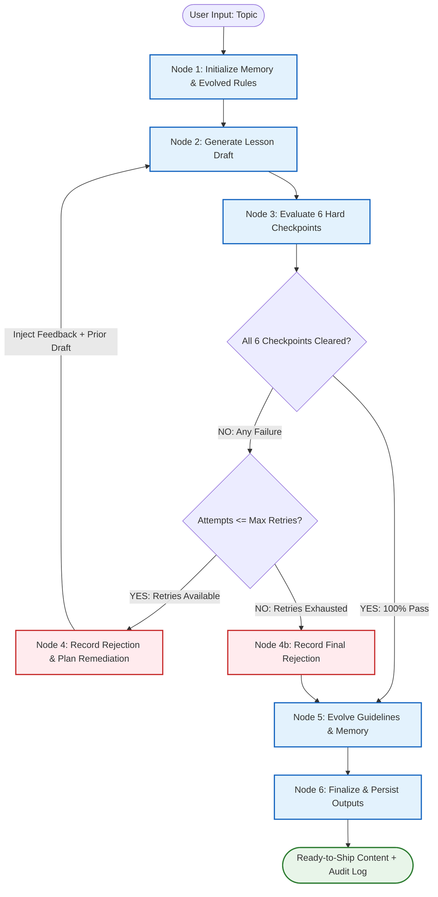
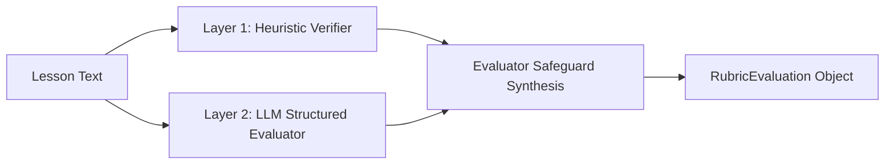

# Comprehensive System Documentation
# Self-Evaluating Lesson Content Generator

> **Author:** Anmol Verma ([@anmolverma29](https://github.com/anmolverma29))  
> **Repository:** [GENAI_Assignment_NxtWave](https://github.com/anmolverma29/GENAI_Assignment_NxtWave)  
> **Topic for Submission:** Introduction to RAG (Retrieval-Augmented Generation)  
> **Stack:** Python 3.13, LangGraph 1.0.3, LangChain Core 1.5.4, Pydantic v2, Streamlit 1.51, Rich, Pytest

---

## Table of Contents
1. [Executive Summary & Problem Statement](#1-executive-summary--problem-statement)
2. [High-Level Architecture & Workflow](#2-high-level-architecture--workflow)
3. [The 6-Checkpoint Binary Rubric](#3-the-6-checkpoint-binary-rubric)
4. [Dual-Layer Evaluator Engine](#4-dual-layer-evaluator-engine)
5. [Generator & Feedback-Conditioned Revision](#5-generator--feedback-conditioned-revision)
6. [Self-Evolving Memory Engine](#6-self-evolving-memory-engine)
7. [LangGraph State Machine Specification](#7-langgraph-state-machine-specification)
8. [Walkthrough of the Submission Run: Introduction to RAG](#8-walkthrough-of-the-submission-run-introduction-to-rag)
9. [Module & API Reference](#9-module--api-reference)
10. [User Interfaces: CLI & Streamlit Dashboard](#10-user-interfaces-cli--streamlit-dashboard)
11. [Testing & Verification Suite](#11-testing--verification-suite)
12. [Configuration & Extensibility Guide](#12-configuration--extensibility-guide)

---

## 1. Executive Summary & Problem Statement

### The Problem
Most AI-driven content generation pipelines operate on a single-pass prompting model: a prompt is submitted, the model outputs text, and the human consumer is forced to proofread and correct the draft. 

When organizations attempt to automate evaluation with LLMs, they typically encounter two failure modes:
1. **Evaluator Leniency & Score Compression:** Giving numerical scores (e.g. 7.5/10) without enforcing hard pedagogical baselines.
2. **Actionless Feedback:** The system states that a lesson is "a bit too technical," but fails to provide structured, actionable remediation instructions to the generator.
3. **No Memory of Failures:** The generator repeats the exact same mistakes on subsequent runs because lessons learned are discarded once the process terminates.

### The Solution
This project implements an autonomous **Generate ➔ Evaluate ➔ Regenerate ➔ Self-Evolve** agentic pipeline. It enforces a strict **binary pass/fail rubric (no partial credit)** across 6 core pedagogical dimensions. If even one checkpoint fails, the lesson is rejected, and a structured diagnostic critique is fed into the generator for revision. Once a draft passes, a meta-evolution optimizer analyzes the failure patterns and sharpens persistent prompt guidelines stored across runs.

---

## 2. High-Level Architecture & Workflow

The system is organized around a cyclic state machine built using **LangGraph**:



### Key Architectural Characteristics
- **Cyclic Execution:** Bounded to a maximum of 1–2 retries (maximum 3 total attempts) to guarantee deterministic termination.
- **Stateful Progression:** State contains the topic, attempt count, current lesson draft, previous drafts, evaluation matrix, rejection audit log, and execution trace.
- **Persistent Storage:** Cross-run memory persists historical runs and learned guidelines to disk in structured JSON files.

---

## 3. The 6-Checkpoint Binary Rubric

The rubric is designed specifically for technical education aimed at complete beginners with zero background in AI. Each checkpoint is strictly **binary (PASS or FAIL)**. There is no partial credit.

| Checkpoint | Identifier | Focus | Hard Pass Criteria | Hard Failure Criteria |
| :--- | :--- | :--- | :--- | :--- |
| **Accurate & Grounded** | `CHK_ACCURACY` | Technical Validity | Correctly describes RAG as dynamic runtime retrieval from external knowledge; clarifies that retrieval does not retrain or fine-tune model weights. | Claims RAG fine-tunes LLM weights, hallucinates non-existent components, or misrepresents vector search. |
| **Beginner-Friendly Language** | `CHK_BEGINNER` | Tone & Accessibility | Assumes ZERO prior AI knowledge. Hooks the reader with an everyday intuitive metaphor (e.g. Open-Book vs Closed-Book Exam) before technical definitions. | Overly academic, dry, uses mathematical formulas, or assumes prior familiarity with vector geometry or machine learning. |
| **Teaches by Example** | `CHK_EXAMPLE` | Concrete Application | Contains at least ONE full end-to-end real-world walkthrough: (1) User question, (2) Naive AI mistake, (3) Retrieved reference document snippet, (4) Grounded answer. | Purely theoretical descriptions; lacks an explicit, concrete walkthrough with specific queries and source citations. |
| **Clear, No Unexplained Jargon** | `CHK_NO_JARGON` | Conceptual Clarity | Every technical term (*embeddings*, *vector database*, *chunking*, *hallucinations*) is accompanied by an immediate plain-English translation and analogy. | Casual drop of terms like "dense vector embeddings", "HNSW graph", or "cosine similarity" without plain-English translation. |
| **Covers All Key Pillars** | `CHK_KEY_POINTS` | Curricular Completeness | Explicitly covers all 3 foundational pillars: (1) **What it is**, (2) **Why it matters / problems it solves**, and (3) **How it works step-by-step**. | Omits any of the 3 pillars (e.g., describes how it works but forgets why companies need it or what problem it solves). |
| **Coherent Pedagogical Flow** | `CHK_COHERENT_FLOW` | Instructional Design | Clean structural progression: Hook ➔ Definition ➔ Why Needed ➔ Core Steps ➔ Practical Walkthrough ➔ Key Takeaways. Clean Markdown headers. | Jumbled sequence, jumping into technical steps before establishing the intuitive hook and the problem, or missing section headers. |

---

## 4. Dual-Layer Evaluator Engine

To eliminate LLM evaluator hallucination and leniency, the evaluator implements a **dual-layer verification pipeline**:



### Layer 1: Deterministic Heuristic Engine (`HeuristicVerifier`)
- **Static Jargon Detection:** Scans for high-dimensional jargon patterns (`"dense vector"`, `"hnsw"`, `"cosine similarity"`, `"embeddings"`) and verifies that required layman translations (`"numerical fingerprint"`, `"smart filing cabinet"`, `"index cards"`) appear in the text.
- **Example Structure Verification:** Verifies the presence of query-retrieval-response markers (`"user question:"`, `"retrieved"`, `"grounded answer"`).
- **Core Pillars Verification:** Scans for distinct coverage of *What it is*, *Why it matters*, and *How it works*.

### Layer 2: Semantic LLM Evaluation (`LessonEvaluator`)
- Uses schema-constrained JSON outputs adhering to Pydantic models (`RubricEvaluation`, `CheckpointResult`).
- Evaluates pedagogical warmth, instructional progression, and conceptual grounding.
- **Safeguard Integration:** If Layer 1 detects a violation that Layer 2 overlooked (e.g. unexplained technical terms), Layer 1 overrides the checkpoint decision to **FAIL** with exact evidence quotes.

---

## 5. Generator & Feedback-Conditioned Revision

The Generator operates in two modes:
1. **Initial Draft Mode (`generate_initial_draft`):**
   - Synthesizes topic requirements, pedagogical instructions, and active evolved guidelines loaded from persistent memory.
2. **Revision Mode (`revise_draft`):**
   - Conditioned on the previous draft, the evaluator critique summary, exact quotes from failed checkpoints, prescriptive remediation instructions, and historical guidelines.
   - The generator is instructed to keep the strong sections while rewriting the deficient parts.

---

## 6. Self-Evolving Memory Engine

The assignment requires the system to:
> `SELF-EVOLVING → learn from repeated failures to sharpen prompts/rubrics`  
> `MEMORY → persists across runs; learns from feedback + logs`

### Architecture of Persistent Storage
- **`data/memory/run_history.json`**:
  Stores complete run telemetry: run ID, timestamp, topic, total attempts, final pass rate, rejection logs, and lesson text.
- **`data/memory/evolved_guidelines.json`**:
  Stores synthesized rules derived from rejections across all runs.

### How Evolution Works in Practice
1. When a run completes, `EvolutionOptimizer` iterates through all rejections.
2. For each failed checkpoint, it extracts an actionable `EvolvedGuideline`:
   - `id`: E.g. `RULE-JARGON-INTR`
   - `rule`: Specific actionable directive.
   - `anti_pattern`: Exact negative pattern to avoid.
   - `best_practice`: Proven technique to use.
   - `frequency_triggered`: Increments each time this failure is encountered across all runs.
3. On future runs, `MemoryStore.get_active_guidelines_text()` loads these rules and automatically injects them into the generator's initial system prompt.

---

## 7. LangGraph State Machine Specification

The state is defined by the TypedDict `LessonGraphState`:

```python
class LessonGraphState(TypedDict):
    topic: str
    target_audience: str
    attempt: int
    max_retries: int
    current_lesson: str
    previous_draft: Optional[str]
    latest_evaluation: Optional[Dict[str, Any]]
    rejection_log: List[Dict[str, Any]]
    is_approved: bool
    status: str
    evolved_guidelines: List[str]
    execution_trace: List[Dict[str, Any]]
```

### State Transitions
1. `initialize` ➔ `generate`
2. `generate` ➔ `evaluate`
3. `evaluate` ➔ Conditional Edge `route_after_evaluation`:
   - If `is_approved == True` ➔ `evolve`
   - If `is_approved == False` ➔ `record_rejection`
4. `record_rejection` ➔ Conditional Edge `route_after_rejection`:
   - If `attempt <= max_retries + 1` ➔ `generate` (loops back with feedback)
   - If `attempt > max_retries + 1` ➔ `evolve` (terminates due to max retries)
5. `evolve` ➔ `finalize`
6. `finalize` ➔ `END`

---

## 8. Walkthrough of the Submission Run: Introduction to RAG

### Attempt 1: Initial Generation (Rejected)
- **Draft Output:** Accurately stated that RAG combines retrieval and generation, but:
  - Used unexplained jargon: *"high-dimensional dense vector embeddings"*, *"HNSW vector database"*, *"cosine similarity search"*.
  - Lacked an intuitive beginner hook or real-world metaphor.
  - Had no concrete end-to-end example query.
- **Evaluator Audit:** **REJECTED (3 Checkpoints Failed)**
  - `CHK_BEGINNER` (FAIL): Relies on technical terminology without beginner framing.
  - `CHK_EXAMPLE` (FAIL): No concrete user inquiry with specific retrieved text provided.
  - `CHK_NO_JARGON` (FAIL): Found dense embeddings and HNSW with no layman explanation.
- **Rejection Log Created:** Logged into `data/outputs/rag_rejection_log.json`.

### Attempt 2: Feedback-Conditioned Regeneration (Approved)
- **Remediation Injected:**
  - *"Introduce the open-book exam metaphor early."*
  - *"Define embeddings using the 'numerical fingerprint' analogy and vector DB as 'smart filing cabinet'."*
  - *"Add a realistic scenario showing: (1) User asks a question, (2) System retrieves specific chunk, (3) Model answers using that chunk."*
- **Draft Improvements:**
  - Hook: *"Imagine taking a tough history exam. In a closed-book exam, you must rely entirely on memory... Now imagine an open-book exam..."*
  - Plain-English Glossary: Embeddings = numerical fingerprints of meaning; Vector DB = smart filing cabinet; Chunking = index cards.
  - Concrete Example: Customer support inquiry for **NovaTech Smartwatch**:
    - User Question: *"Can I wear my NovaWatch X in a heated sauna?"*
    - Without RAG: Naive model gives incorrect advice.
    - With RAG: Retrieves Section 4.2 of user manual warning about heat and steam damaging seals.
    - Grounded Response: Safe, accurate answer citing Section 4.2.
- **Evaluator Audit:** **100% PASS across all 6 checkpoints.**
- **Evolution Triggered:** Guidelines saved to persistent memory.
- **Final Output Saved:** [data/outputs/rag_lesson_final.md](file:///c:/Users/anmol/Downloads/GENAI_Assignment_NxtWave/data/outputs/rag_lesson_final.md).

---

## 9. Module & API Reference

| Module | Purpose | Key Classes & Functions |
| :--- | :--- | :--- |
| `src/models.py` | Data schemas & models | `CheckpointID`, `CheckpointResult`, `RubricEvaluation`, `RejectionLogEntry`, `EvolvedGuideline`, `RunMemoryRecord`, `PipelineOutput` |
| `src/config.py` | Configuration & environment | `Config`: Manages model keys, retries, file paths, and active provider selection |
| `src/llm_provider.py` | Provider abstraction | `BaseLLMProvider`, `GeminiProvider`, `OpenAIProvider`, `MockProvider`, `get_llm_provider` |
| `src/prompts.py` | Prompts & templates | `GENERATOR_SYSTEM_PROMPT`, `GENERATOR_REVISION_TEMPLATE`, `EVALUATOR_SYSTEM_PROMPT`, `META_EVOLUTION_SYSTEM_PROMPT` |
| `src/evaluator.py` | Rubric evaluation engine | `HeuristicVerifier`, `LessonEvaluator` |
| `src/generator.py` | Lesson generation & revision | `LessonGenerator`: `generate_initial_draft`, `revise_draft` |
| `src/memory.py` | Cross-run persistence | `MemoryStore`: `save_run`, `get_all_runs`, `save_evolved_guideline`, `get_evolved_guidelines`, `get_checkpoint_failure_frequencies` |
| `src/evolution.py` | Self-evolution meta-optimizer | `EvolutionOptimizer`: `evolve_from_rejection_log` |
| `src/graph.py` | LangGraph agentic loop | `LessonPipelineGraph`, `LessonGraphState` |
| `src/pipeline.py` | Facade entrypoint | `run_pipeline(topic, max_retries, provider_type, ...)` |

---

## 10. User Interfaces: CLI & Streamlit Dashboard

### 1. Command Line Interface (`main.py`)
Provides rich, color-coded terminal execution:
```bash
python main.py --topic "Introduction to RAG"
```
**Options:**
- `--topic`: Custom lesson topic (default: "Introduction to RAG").
- `--provider`: `mock`, `gemini`, or `openai`.
- `--max-retries`: Maximum retries allowed (default: 2).

### 2. Streamlit Web Dashboard (`app.py`)
Run the visual interactive application:
```bash
streamlit run app.py
```
**Features:**
- **Interactive Controls:** Topic dropdown, provider switcher, API key fields, and retry slider.
- **Workflow DAG:** Visual Mermaid diagram of the LangGraph state machine.
- **4 Comprehensive Tabs:**
  1. *Passing Lesson:* Rendered Markdown lesson with a 1-click download button.
  2. *Rejection Log & Diffs:* Audit trail of every rejection, evidence quotes, and remediations.
  3. *Rubric Checkpoints Matrix:* Color-coded cards for each of the 6 checkpoints.
  4. *Persistent Memory & Evolution:* Failure frequency bar chart, historical runs table, and evolved guidelines.

---

## 11. Testing & Verification Suite

The project includes 13 automated unit and integration tests located in `tests/`:

```bash
python -m pytest tests/ -v
```

### Test Coverage Breakdown
- `tests/test_rubric.py`:
  - `test_heuristic_verifier_jargon_failure`: Asserts unexplained jargon is detected and failed.
  - `test_heuristic_verifier_jargon_pass`: Asserts jargon accompanied by analogies passes.
  - `test_heuristic_verifier_example_failure`: Asserts missing walkthrough fails.
  - `test_heuristic_verifier_example_pass`: Asserts query-retrieval-answer walkthrough passes.
  - `test_heuristic_verifier_key_points`: Asserts What, Why, and How detection.
  - `test_evaluator_binary_no_partial_credit`: Asserts that 1 failure sets `all_passed` to False.
  - `test_evaluator_master_draft_passes_all`: Asserts that the passing draft clears all 6 checkpoints.
- `tests/test_memory.py`:
  - `test_save_and_retrieve_runs`: Tests JSON persistence of run records.
  - `test_save_and_update_guidelines`: Tests saving and frequency tracking of rules.
  - `test_checkpoint_failure_frequencies`: Tests aggregation of failure frequencies.
- `tests/test_evolution.py`:
  - `test_evolution_from_rejection_log`: Tests extraction of guidelines from rejection logs.
- `tests/test_graph.py`:
  - `test_langgraph_full_loop_success`: Tests complete generate ➔ evaluate ➔ reject ➔ regenerate ➔ approve cycle.
  - `test_langgraph_bounded_termination`: Asserts that execution strictly terminates within `max_retries`.

---

## 12. Configuration & Extensibility Guide

### Adding a New Checkpoint
To add a new checkpoint to the rubric:
1. Add an enum value in `src/models.py` (`CheckpointID`).
2. Add description metadata in `CheckpointMeta.DESCRIPTIONS`.
3. Add pass/fail criteria to `EVALUATOR_SYSTEM_PROMPT` in `src/prompts.py`.
4. (Optional) Add a heuristic check in `HeuristicVerifier` in `src/evaluator.py`.

### Connecting a New LLM Provider
To add a new LLM provider (e.g. Anthropic Claude, Ollama, Groq):
1. Create a class subclassing `BaseLLMProvider` in `src/llm_provider.py`.
2. Implement `generate_text` and `generate_structured`.
3. Register the provider in `get_llm_provider` factory.

---

## 📄 Output Artifacts Summary
- **Final Shipped Lesson:** [`data/outputs/rag_lesson_final.md`](file:///c:/Users/anmol/Downloads/GENAI_Assignment_NxtWave/data/outputs/rag_lesson_final.md)
- **Rejection Audit Log:** [`data/outputs/rag_rejection_log.json`](file:///c:/Users/anmol/Downloads/GENAI_Assignment_NxtWave/data/outputs/rag_rejection_log.json)
- **Persistent Run History:** [`data/memory/run_history.json`](file:///c:/Users/anmol/Downloads/GENAI_Assignment_NxtWave/data/memory/run_history.json)
- **Evolved Guidelines:** [`data/memory/evolved_guidelines.json`](file:///c:/Users/anmol/Downloads/GENAI_Assignment_NxtWave/data/memory/evolved_guidelines.json)
